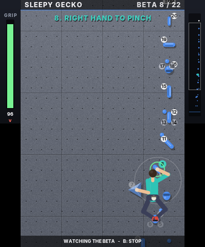
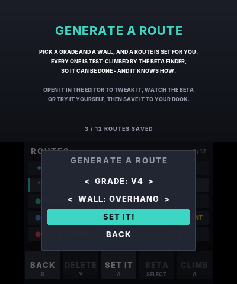

# Boulder 3DS

A bouldering game for the Nintendo 3DS (homebrew). **Set your own routes** on a
climbing wall by tapping holds onto it with the stylus, or **generate** one at
the grade you want, then **climb them** hand by hand and foot by foot before
your grip runs out. A built-in **beta finder** works out every route's grade
and the best way up, and can show you the moves.

  

  

## Features

- The two screens are one tall wall: the touch screen is the part you're
  working on, the top screen shows what's above you
- A climber with four limbs. Pick up a hand or foot, reach for a hold, let go
  to grab it. The body settles between the holds under gravity, and legs
  stand you up over high feet so you can reach further
- Grip meter: jugs are restful, crimps and slopers pump you out, cutting your
  feet loose puts all your weight on your hands, and steeper walls are harder.
  Run out and you fall onto the crash pad
- Route editor with nine hold types (see below), drag to move, tap again to
  turn, start holds (S) and a top hold (TOP), four wall angles (slab,
  vertical, overhang, roof), eight hold colors, and names typed on the 3DS
  keyboard
- **Beta finder**: a solver climbs the route with the game's own physics,
  trying every hand and foot on every hold in reach, and keeps the moves that
  gain the most height for the least grip. It gives each route its **V grade**
  (from how pumped the climb gets and how bad the holds are) and its **beta**:
  watch the climber do the moves, or show the numbered moves on the holds
  while you climb
- **Route generator**: pick a grade (V0 to V10) and a wall. It sets a line of
  holds, has the beta finder climb it, throws away routes that can't be
  climbed, and adjusts until the grade matches
- Test-climb a route straight from the editor
- Grade, best time, sends and attempts for each route
- Up to 12 routes, saved to `sdmc:/3ds/bouldering3ds/routes.dat`. Three sample
  routes are there to start with: **Warm Up** (slab), **Crimp Ladder**
  (vertical) and **The Cave** (overhang)
- Stereoscopic 3D: holds and the climber stand off the wall when the 3D slider
  is up
- Music and sound effects synthesised on the console at start-up

## Install with a QR code (no computer needed)

On a 3DS with custom firmware, open **FBI**, choose **Remote Install -> Scan QR
Code** and point the camera at this code. It always installs the newest build.


The same file is at
<https://github.com/Dipish3639/Bouldering-3ds/releases/latest/download/bouldering3ds.cia>.

## How to climb

You start with both hands on the start holds and your feet on the mat. **Match
both hands on the TOP hold** to send the route.

| Control | Action |
|---|---|
| Stylus | Drag a hand or foot onto a hold and lift the stylus to grab it |
| Hold **L** / **R** | Move your left / right hand. Steer with the Circle Pad or D-Pad, release to grab |
| Hold **Y** / **A** | Move your left / right foot the same way |
| SELECT | Show or hide the beta: numbered moves next to the holds (white = hands, grey = feet) |
| START | Pause (resume, restart, watch the beta, quit) |

- The circle around a moving limb is how far it can reach. A hold glows green
  when you can grab it
- You always need one hand on the wall. Miss a hold and the hand goes back
  where it was
- Feet can stand on any hold. On slab and vertical walls a foot let go on
  blank wall smears on it
- The GRIP bar on the left of the top screen shows your stamina; the arrow
  under it shows whether you're tiring or recovering. Good footholds and big
  holds let you recover

## Holds

| Hold | For hands | For feet |
|---|---|---|
| Jug | Big and incut: you can rest on it | Great |
| Edge | A long flat rail: good | Great |
| Crimp | A thin edge: pumpy | Good |
| Pocket | A two-finger hole: very pumpy | Poor |
| Sloper | Round and smooth: gets worse the steeper the wall | Poor |
| Pinch | Squeeze it from the sides | OK |
| Undercling | Lip underneath: great once your shoulder is above it, awful to reach up to | Poor |
| Volume | A big triangle: slopey for hands, and steeper walls make it worse | Great |
| Foot chip | Too small to hold | Great |

## Watching the beta

Pick a route on the list and press **BETA** (SELECT), or choose **WATCH THE
BETA** from the pause menu or the editor menu. The climber does the moves the
beta finder found, one at a time, with each move named on the top screen.
Routes are graded and solved when you save them; routes from an older save are
graded the first time the game starts.

## Generating a route

Pick **GENERATE A ROUTE** on the route list, choose a grade and a wall (or
ANY), and press **SET IT!**. The new route opens in the editor already
graded, so you can climb it, watch its beta, change it, or save it to your
book.

## How to set a route

Choose **+ NEW ROUTE** on the route list (or pick a route and press **X** to
edit it).

| Control | Action |
|---|---|
| Toolbar (bottom of the touch screen) | Pick a hold type, START, TOP or ERASE (the name pops up when you pick one) |
| Tap the wall | Place the selected hold type |
| Tap a hold | Turn it (same type) or change it to the selected type. START / TOP / ERASE act on the hold |
| Drag a hold | Move it (drag near an edge to scroll) |
| D-Pad / Circle Pad up and down | Scroll the wall |
| L / R | Previous / next tool |
| X | Test climb |
| START | Menu: save, test, watch the beta, rename, wall angle, color, exit |

A route needs one or two start holds within reach of the mat (below the
dotted line) and one top hold. The grade in the editor header starts with a
`~` while it's only a guess from the holds; saving runs the beta finder and
gives the real grade (or `V??` if it couldn't find a way up).

## Audio needs the DSP firmware

The 3DS sound hardware needs `/3ds/dspfirm.cdc` on the SD card. Most custom
firmware setups already have it; if not, run the
[DSP1](https://github.com/zoogie/DSP1/releases) homebrew once to dump it.
Without it the game still runs, just silently.

## Building

Requires [devkitPro](https://devkitpro.org/wiki/Getting_Started) with the
`3ds-dev` group installed.

```sh
make
```

This produces `bouldering3ds.3dsx` for the Homebrew Launcher.

```sh
make cia MAKEROM=/path/to/makerom BANNERTOOL=/path/to/bannertool
```

builds an installable `bouldering3ds.cia` with its own HOME Menu icon, banner
and jingle (from `meta/`, generated by `tools/genassets.py`). `makerom` comes
from [3DSGuy/Project_CTR](https://github.com/3DSGuy/Project_CTR) and
`bannertool` from [diasurgical/bannertool](https://github.com/diasurgical/bannertool).

Every push is built by GitHub Actions, and every push to the default branch is
published as a release (which the QR code above points at).

## Testing on a PC

- `tools/simtest.sh` runs the beta finder on every sample route and checks that
  replaying its moves tops out, generates 20 routes across grades and walls
  and checks they're all climbable and near the asked-for grade, and checks
  saving and loading (including saves from the first version)
- `tools/smoketest.sh` runs the real game loop against a stub of libctru with
  a scripted player (menus, stylus and button climbing, building, testing,
  renaming, grading and saving a route, watching the beta, generating a
  route, deleting) under AddressSanitizer
- `tools/preview.sh preview` writes sample screens to `preview/` as images

## Code layout

- `source/climb.c` – the climber: limbs, body solver, stamina, falling, topping out
- `source/route.c` – holds, routes, quick grade guess, sample routes, save file
- `source/beta.c` – the beta finder: searches for the moves up a route and grades it
- `source/gen.c` – the route generator
- `source/render.c` – the wall, holds, climber, HUD and menus on both screens
- `source/gfx.c` – rectangles, anti-aliased shapes, blits and text on the framebuffers
- `source/font_data.c` – generated by `tools/genfont.py` from Inter ExtraBold
  (SIL Open Font License 1.1)
- `source/synth.c` – music and sound effects synthesiser
- `source/audio.c` – plays the synthesised sounds through the 3DS DSP (ndsp)
- `source/main.c` – modes, input, the editor and saving
