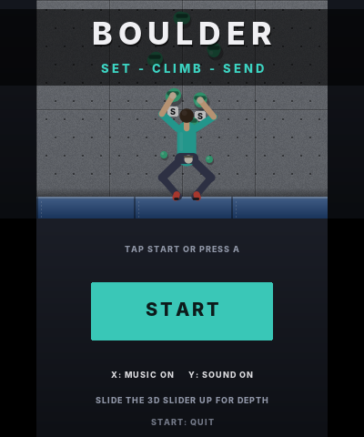
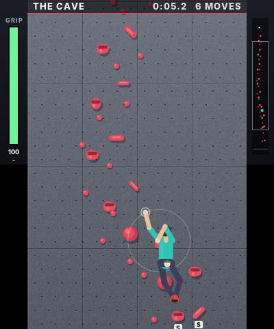
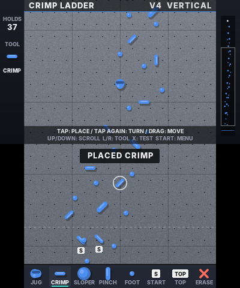
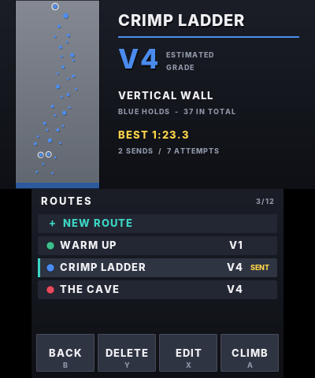
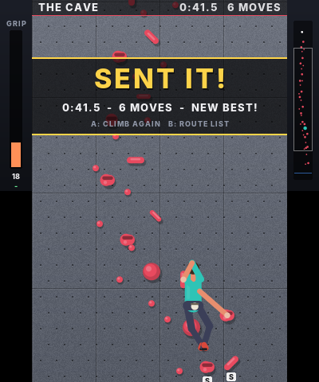

# Boulder 3DS

A bouldering game for the Nintendo 3DS (homebrew). **Set your own routes** on a
climbing wall by tapping holds onto it with the stylus, then **climb them**
hand by hand and foot by foot before your grip runs out.

  

 

## Features

- The two screens are one tall wall: the touch screen is the part you're
  working on, the top screen shows what's above you
- A climber with four limbs. Pick up a hand or foot, reach for a hold, let go
  to grab it. The body settles between the holds under gravity, and legs
  stand you up over high feet so you can reach further
- Grip meter: jugs are restful, crimps and slopers pump you out, cutting your
  feet loose puts all your weight on your hands, and steeper walls are harder.
  Run out and you fall onto the crash pad
- Route editor: five hold types (jug, crimp, sloper, pinch, foot chip), drag to
  move, tap again to turn, start holds (S) and a top hold (TOP), four wall
  angles (slab, vertical, overhang, roof), eight hold colors, and names
  typed on the 3DS keyboard
- Test-climb a route straight from the editor
- Estimated V grade, best time, sends and attempts for each route
- Up to 12 routes, saved to `sdmc:/3ds/bouldering3ds/routes.dat`. Three sample
  routes are there to start with: **Warm Up** (slab), **Crimp Ladder**
  (vertical) and **The Cave** (overhang)
- Stereoscopic 3D: holds and the climber stand off the wall when the 3D slider
  is up
- Music and sound effects synthesised on the console at start-up

## Install with a QR code (no computer needed)

On a 3DS with custom firmware, open **FBI**, choose **Remote Install -> Scan QR
Code** and point the camera at this code. It always installs the newest build.


The same file is at
<https://github.com/Dipish3639/Bouldering-3ds/releases/latest/download/bouldering3ds.cia>.

## How to climb

You start with both hands on the start holds and your feet on the mat. **Match
both hands on the TOP hold** to send the route.

| Control | Action |
|---|---|
| Stylus | Drag a hand or foot onto a hold and lift the stylus to grab it |
| Hold **L** / **R** | Move your left / right hand. Steer with the Circle Pad or D-Pad, release to grab |
| Hold **Y** / **A** | Move your left / right foot the same way |
| START | Pause (resume, restart, quit) |

- The circle around a moving limb is how far it can reach. A hold glows green
  when you can grab it
- You always need one hand on the wall. Miss a hold and the hand goes back
  where it was
- Feet can stand on any hold. On slab and vertical walls a foot let go on
  blank wall smears on it
- The GRIP bar on the left of the top screen shows your stamina; the arrow
  under it shows whether you're tiring or recovering. Good footholds and big
  holds let you recover

## How to set a route

Choose **+ NEW ROUTE** on the route list (or pick a route and press **X** to
edit it).

| Control | Action |
|---|---|
| Toolbar (bottom of the touch screen) | Pick JUG, CRIMP, SLOPER, PINCH, FOOT, START, TOP or ERASE |
| Tap the wall | Place the selected hold type |
| Tap a hold | Turn it (same type) or change it to the selected type. START / TOP / ERASE act on the hold |
| Drag a hold | Move it (drag near an edge to scroll) |
| D-Pad / Circle Pad up and down | Scroll the wall |
| L / R | Previous / next tool |
| X | Test climb |
| START | Menu: save, test, rename, wall angle, color, exit |

A route needs one or two start holds within reach of the mat (below the
dotted line) and one top hold.

## Audio needs the DSP firmware

The 3DS sound hardware needs `/3ds/dspfirm.cdc` on the SD card. Most custom
firmware setups already have it; if not, run the
[DSP1](https://github.com/zoogie/DSP1/releases) homebrew once to dump it.
Without it the game still runs, just silently.

## Building

Requires [devkitPro](https://devkitpro.org/wiki/Getting_Started) with the
`3ds-dev` group installed.

```sh
make
```

This produces `bouldering3ds.3dsx` for the Homebrew Launcher.

```sh
make cia MAKEROM=/path/to/makerom BANNERTOOL=/path/to/bannertool
```

builds an installable `bouldering3ds.cia` with its own HOME Menu icon, banner
and jingle (from `meta/`, generated by `tools/genassets.py`). `makerom` comes
from [3DSGuy/Project_CTR](https://github.com/3DSGuy/Project_CTR) and
`bannertool` from [diasurgical/bannertool](https://github.com/diasurgical/bannertool).

Every push is built by GitHub Actions, and every push to the default branch is
published as a release (which the QR code above points at).

## Testing on a PC

- `tools/simtest.sh` has a bot climb every sample route through the same
  climbing code the game uses, and checks saving and loading
- `tools/smoketest.sh` runs the real game loop against a stub of libctru with
  a scripted player (menus, stylus and button climbing, building, testing,
  renaming, saving and deleting a route) under AddressSanitizer
- `tools/preview.sh preview` writes sample screens to `preview/` as images

## Code layout

- `source/climb.c` – the climber: limbs, body solver, stamina, falling, topping out
- `source/route.c` – holds, routes, grade estimate, sample routes, save file
- `source/render.c` – the wall, holds, climber, HUD and menus on both screens
- `source/gfx.c` – rectangles, anti-aliased shapes, blits and text on the framebuffers
- `source/font_data.c` – generated by `tools/genfont.py` from Inter ExtraBold
  (SIL Open Font License 1.1)
- `source/synth.c` – music and sound effects synthesiser
- `source/audio.c` – plays the synthesised sounds through the 3DS DSP (ndsp)
- `source/main.c` – modes, input, the editor and saving
